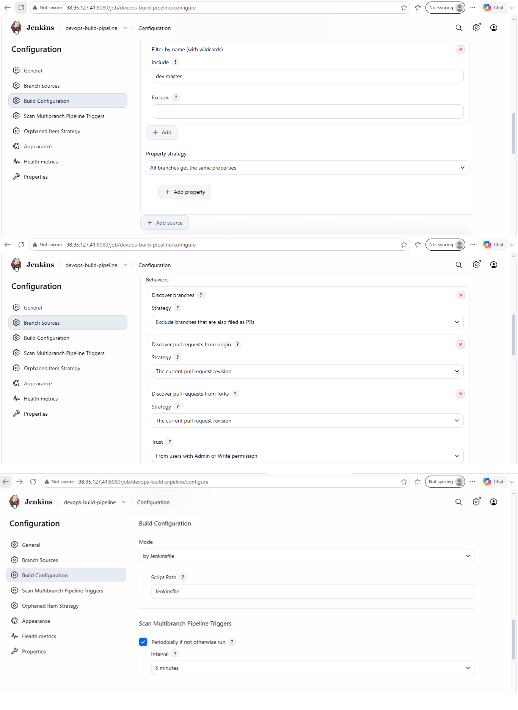
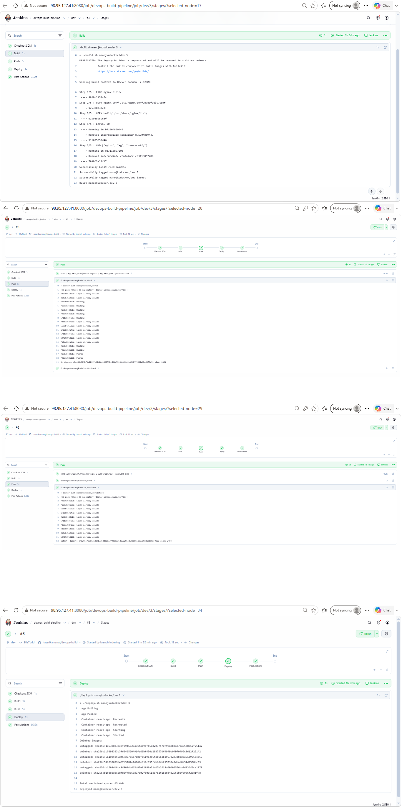
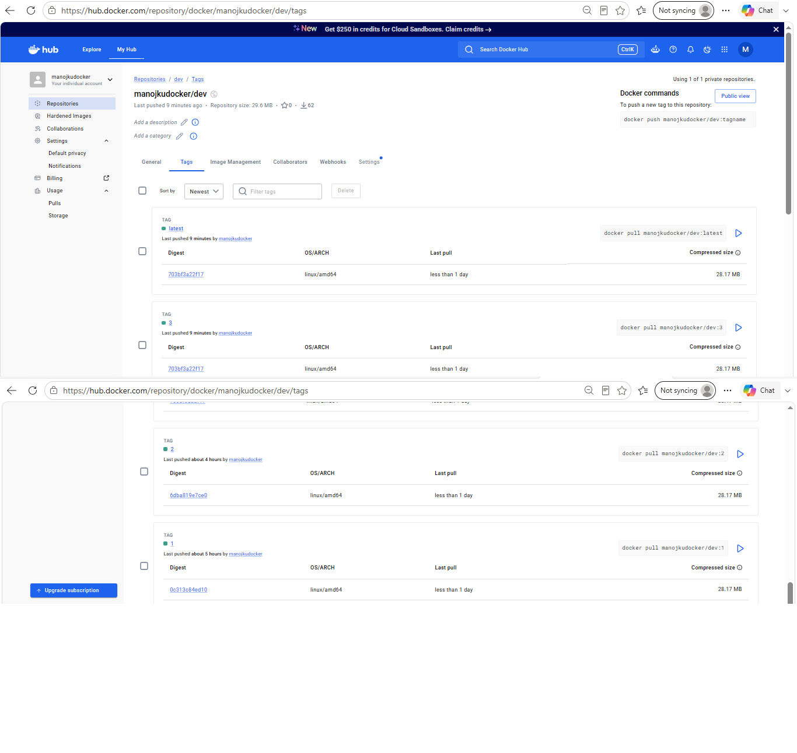

# DevOps Project 3: React E-Commerce App, Docker + Jenkins CI/CD on AWS

A pre-built React e-commerce application ("OnlineShop") packaged with Docker, built and deployed automatically by Jenkins on every push, and monitored with Uptime Kuma.

## Submission details

| Item | Value |
|---|---|
| GitHub repo | https://github.com/hazarikamanoj/devops-build |
| Deployed site | http://98.95.127.41 |
| Docker image (dev, public) | `manojkudocker/dev` |
| Docker image (prod, private) | `manojkudocker/prod` |
| Jenkins | http://98.95.127.41:8080 (login required) |
| Monitoring | Uptime Kuma on port 3001 (restricted access) |
| Source application | https://github.com/sriram-R-krishnan/devops-build (pre-built `build/` folder) |

## How it works

```
 git push (dev)  ──┐
                   ├─> GitHub webhook ─> Jenkins (Multibranch Pipeline, on EC2)
 git merge master ─┘                          │
                                              ├─ Build  : ./build.sh  (docker build)
                                              ├─ Push   : Docker Hub  (dev repo or prod repo)
                                              └─ Deploy : ./deploy.sh (docker compose on the same EC2 host, port 80)

 Uptime Kuma ──(HTTP check every 60 s)──> http://98.95.127.41 ──> Telegram alert when DOWN
```

- Push to `dev`: the image is built and pushed to `manojkudocker/dev`, then deployed.
- Merge `dev` into `master`: the image is built and pushed to `manojkudocker/prod`, then deployed.
- Images are tagged with the Jenkins build number and `latest`.

## Repository contents

| File | Purpose |
|---|---|
| `build/` | Pre-built React application |
| `Dockerfile` | `nginx:alpine` image serving `build/` on port 80 |
| `nginx.conf` | Serves the single-page app (falls back to `index.html`) |
| `docker-compose.yml` | Runs the image on port 80 (`IMAGE` and `TAG` come from the environment) |
| `build.sh` | Builds and tags the Docker image |
| `deploy.sh` | Pulls the image and starts it with Docker Compose |
| `Jenkinsfile` | Build, Push and Deploy stages; picks the dev or prod repo by branch |
| `.dockerignore`, `.gitignore` | Keep the image and the repo clean |

## Infrastructure

- **AWS EC2:** `t3.small`, Ubuntu 24.04, region `us-east-1`, with an Elastic IP. The `t2.micro` type from the assignment was not available in this region for the account, so the equivalent `t3.small` was used.
- **Security group:**

| Port | Source | Reason |
|---|---|---|
| 22 (SSH) | Administrator's IP only | Server login |
| 80 (HTTP) | Anywhere | Public access to the application |
| 8080 | Anywhere | Jenkins UI and GitHub webhook (login required) |
| 3001 | Administrator's IP range only | Uptime Kuma |

- **Docker Hub:** `dev` (public) and `prod` (private) repositories. Jenkins authenticates with an access token stored as a Jenkins credential (`dockerhub-creds`), never in the repo.
- **Jenkins:** Multibranch Pipeline `devops-build-pipeline`, GitHub branch source with the `github-token` credential, and a GitHub webhook (`/github-webhook/`) for automatic builds on both `dev` and `master`.
- **Monitoring:** Uptime Kuma (Docker) with an HTTP monitor on the site, checked every 60 seconds. A Telegram bot sends a message when the application goes down, and another when it recovers.

## Screenshots

All screenshots are in the [`screenshots/`](screenshots/) folder.

### Version control


### Bash scripts
**build.sh** run locally (`./build.sh manojkudocker/dev test`): builds the image and tags it with the given tag and `latest`


**deploy.sh** (pulls the image and starts it with Docker Compose)


### Jenkins
**Login page**


**Credentials** (secrets masked)


**Configuration settings**




**Branches and Jenkinsfile steps**




**Execute step commands: `dev` build** (checkout, `./build.sh`, `docker push`, `./deploy.sh`, success)


**Execute step commands: `master` build** (pushes to the prod repo)


### Automatic build trigger


### Docker Hub
**Access token used by Jenkins** (scope: repo read, write, delete; the token value itself is never shown)


**Repositories and tags**





### AWS


### Deployed site


### Monitoring health check status
**Notification setup**


**Application stopped (`docker stop react-app`): DOWN alert**


**Application restarted (`docker start react-app`): recovery**


## Notes

- Both branches deploy to the same EC2 host on port 80, so the version currently live is whichever build ran last.
- Uptime Kuma sends a recovery message when the app comes back, in addition to the DOWN alert.
- The Jenkins UI is served over plain HTTP, which is acceptable for this short-lived project. For anything long-lived, put it behind HTTPS and restrict the source IPs.
- No credentials are stored in this repository. Docker Hub and GitHub tokens live in the Jenkins credential store.
